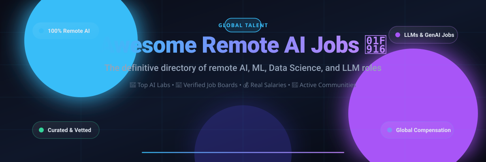
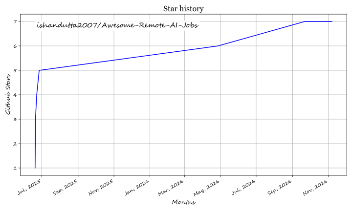

  

# Awesome Remote AI Jobs 🤖

  <strong>A curated list of awesome remote job boards, companies, interview prep, and salary resources for Artificial Intelligence (AI), Machine Learning (ML), Deep Learning, and Generative AI professionals.</strong>

      

  Inspired by the <a href="https://github.com/lukasz-madon/awesome-remote-job">awesome-remote-job</a> list. Looking for global remote opportunities in AI engineering, MLOps, LLM research, data annotation, and machine learning infrastructure? You're in the right place! 🌐

---

## 📑 Contents

- [🌐 Job Boards](#-job-boards)
  - [🏢 General Tech & Remote](#-general-tech--remote)
  - [🧠 AI/ML Specific](#-aiml-specific)
- [🚀 Companies Hiring Remotely](#-companies-hiring-remotely)
- [📚 Resources](#-resources)
  - [🎯 Interview Prep](#-interview-prep)
  - [🤝 Communities](#-communities)
  - [💰 Salary Negotiation & Benchmarks](#-salary-negotiation--benchmarks)
- [📈 Star History](#-star-history)
- [💖 Support](#-support)
- [✨ Contributing](#-contributing)

---

## 🌐 Job Boards

These top platforms frequently feature remote AI, Machine Learning, Deep Learning, and Data Science positions worldwide.

### 🏢 General Tech & Remote

| Name | Focus | Notes | Access |
| :--- | :--- | :--- | :--- |
| [FlexJobs](https://www.flexjobs.com/) 💼 | Hand-screened Remote Roles | Vetted, scam-free listings for remote and flexible jobs. | Paid |
| [Himalayas](https://himalayas.app/) 🏔️ | Remote Tech Jobs | Excellent UI and deep company culture and compensation insights. | Free |
| [Hired](https://hired.com/) 🎯 | Tech Talent Marketplace | Companies apply directly to you; set your remote preferences. | Free |
| [Jobspresso](https://jobspresso.co/) ☕ | Curated Tech & Remote Careers | Hand-picked remote tech, data science, and engineering roles. | Free |
| [LinkedIn Jobs](https://www.linkedin.com/jobs/) 🌐 | Broad Tech & AI Roles | Use filters for "Remote" along with keywords like "AI", "Machine Learning", "LLM". | Free |
| [NoDesk](https://nodesk.co/remote-jobs/) 🎒 | Digital Nomads & Remote Tech | Curated remote opportunities across engineering, product, and AI. | Free |
| [Remote OK](https://remoteok.com/) 🌍 | Tech & AI Engineering | High-volume remote job board with dedicated AI/ML tags and filters. | Free |
| [Remote.co](https://remote.co/remote-jobs/) 🏡 | Fully Remote | Great for discovering companies with an established remote-first culture. | Free |
| [Remotive](https://remotive.com/) ⚡ | Remote Startups & Tech | Features an active, dedicated AI and data jobs category. | Free |
| [We Work Remotely](https://weworkremotely.com/) 💻 | Remote-First Tech Community | High-traffic job board with dedicated programming and data sections. | Free |
| [Wellfound](https://wellfound.com/) 🦄 | AI Startups & Ventures | Formerly AngelList Talent; direct access to founders and seed/Series A-C startups. | Free |
| [Working Nomads](https://www.workingnomads.com/jobs) 🧭 | Remote Work & Tech | Curated remote opportunities with engineering, analytics, and data filters. | Free |

### 🧠 AI/ML Specific

| Name | Focus | Notes | Access |
| :--- | :--- | :--- | :--- |
| [AI Jobs](https://ai-jobs.net/) 🧠 | AI, ML & Data Science | Dedicated, high-signal niche job board for AI and ML practitioners. | Free |
| [AI Trainer Jobs](https://aitrainer.jobs/) 🏷️ | RLHF & Data Annotation | Dedicated to AI model evaluation, prompt engineering, and training jobs. | Free |
| [DeepLearning.ai Jobs](https://jobs.deeplearning.ai/) 🎓 | AI & Deep Learning | Curated job portal backed by Andrew Ng's DeepLearning.ai platform. | Free |
| [Gridnaut Recruiting](https://gridnaut.site/jobs/) 🛰️ | AI Training, Evaluation & Domain Experts | Curated Mercor referral roles; 100% remote positions ($23–$180/hr). | Free |
| [Hugging Face Jobs](https://huggingface.co/jobs) 🤗 | NLP, Transformers & Open Source AI | Careers at Hugging Face and partner companies utilizing open source AI. | Free |
| [Kaggle Jobs](https://www.kaggle.com/jobs) 📊 | Data Science & ML | Listings directly targeted at data scientists and competitive ML builders. | Free |
| [MLRemotely](https://mlremotely.com/) 🤖 | Machine Learning & Deep Learning | Curated remote ML engineering, computer vision, and research openings. | Free |
| [Outlier.ai](https://outlier.ai/) ✍️ | AI Model Training & Evaluation | Freelance/remote AI training, code verification, RLHF, and domain fine-tuning. | Free |
| [RobotTraining.jobs](https://robottraining.jobs/remote-robot-training-jobs) 🦾 | Robot Training & Physical AI Data | Remote teleoperation and at-home video capture for physical AI training with posted pay. | Free |
| [ThirstySprout](https://thirstysprout.com/) 🌿 | Vetted ML/MLOps Specialists | Focused talent network matching senior AI engineers with top companies. | Free |

---

## 🚀 Companies Hiring Remotely

A curated directory of top AI research labs, startups, and remote-first enterprises frequently hiring AI/ML engineers, research scientists, and developers worldwide.

| Company | Specialization | Why it's awesome |
| :--- | :--- | :--- |
| [**Airbnb**](https://www.airbnb.com/careers) 🏠 | Travel & Hospitality AI | Exemplary "Live and Work Anywhere" policy with deep AI personalization. |
| [**Anthropic**](https://www.anthropic.com/careers) 🛡️ | AI Safety & Frontier Research | Building reliable, steerable, and interpretable foundation models (Claude). |
| [**Anyscale**](https://www.anyscale.com/careers) ⚡ | Distributed Systems (Ray) | Scaling AI workloads from local laptops to distributed cloud clusters. |
| [**Cohere**](https://cohere.com/careers) 🗣️ | Large Language Models & Embeddings | Enterprise-grade foundation models, retrieval augmented generation, and embeddings. |
| [**Databricks**](https://www.databricks.com/company/careers) 🧱 | Unified Data & AI Platform | Unifying data lakes, machine learning pipelines, and foundational model training (MosaicML). |
| [**Deepgram**](https://deepgram.com/careers) 🎙️ | Speech AI & Voice Recognition | State-of-the-art real-time audio intelligence and speech-to-text models at scale. |
| [**DeepMind**](https://www.deepmind.com/careers) 🔬 | Frontier AI Research | Advancing fundamental scientific research and next-gen intelligence architectures. |
| [**ElevenLabs**](https://elevenlabs.io/careers) 🔊 | Voice AI & Generative Audio | Pioneering generative audio, synthetic voices, and multilingual voice dubbing. |
| [**Fireworks AI**](https://fireworks.ai/company/careers) 🎆 | Ultra-Fast AI Inference | High-performance inference engine for serving open-weight foundation models. |
| [**GitLab**](https://about.gitlab.com/jobs/) 🦊 | DevSecOps & AI Code Assistance | All-remote pioneer building GitLab Duo, an AI-powered software development assistant. |
| [**Groq**](https://groq.com/careers/) ⚡ | LPUs & Real-Time Inference | Hardware and developer cloud engineered for ultra-fast, real-time LLM token generation. |
| [**Hugging Face**](https://huggingface.co/) 🤗 | NLP & Open Source AI Community | The heart of open-source AI and model hubs; strong remote-first culture. |
| [**LangChain**](https://www.langchain.com/careers) 🦜🔗 | LLM Orchestration & Agents | The defining framework for building LLM-powered applications, tools, and autonomous agents. |
| [**Mistral AI**](https://mistral.ai/news/jobs/) 🇫🇷 | Open-Weight Frontier AI Models | Leading open-weight model laboratory delivering fast, highly-efficient foundation models. |
| [**Modal**](https://modal.com/careers) ☁️ | Serverless GPU Infrastructure | Run generative AI models, batch inference, and data pipelines on cloud GPUs effortlessly. |
| [**OpenAI**](https://openai.com/careers) 🌟 | AI Research & Products (GPT, DALL-E) | Creators of GPT-4, ChatGPT, and Sora; defining the frontier of artificial general intelligence. |
| [**Perplexity AI**](https://www.perplexity.ai/careers) 🔍 | Conversational Search & Answers | Reimagining web search and knowledge synthesis using cutting-edge LLMs. |
| [**Runway**](https://runwayml.com/careers) 🎥 | Generative Video & Creative AI | Leading the revolution in AI video generation, visual tools, and world models (Gen-2/3). |
| [**Scale AI**](https://scale.com/careers) 🏷️ | Data Labeling & AI Evaluation | High-quality training data, fine-tuning, and evaluation powering the world's top AI labs. |
| [**Together AI**](https://www.together.ai/careers) 🤝 | Generative AI Cloud & Research | High-performance infrastructure and research platform for training and serving open models. |
| [**Vercel**](https://vercel.com/careers) 🔺 | AI SDK & Fullstack AI Web Apps | Empowering developers to build responsive, AI-first user interfaces and streaming apps. |
| [**Weights & Biases**](https://wandb.ai/site/careers) 🛠️ | MLOps & Experiment Tracking | Essential developer-first platform for tracking, evaluating, and fine-tuning models. |
| [**Zoom**](https://careers.zoom.us/) 📹 | AI Collaboration Tools | Integrating real-time generative AI companions directly into daily communication. |

---

## 📚 Resources

Essential guides, tools, and references to accelerate your remote AI/ML career search.

### 🎯 Interview Prep

| Resource | Description | Access |
| :--- | :--- | :--- |
| [ApplyArc](https://applyarc.com/) 📝 | STAR Method Behavioral Prep | Tailors behavioral interview answers and stories directly to specific job descriptions. | Paid |
| [Final Round AI](https://www.finalroundai.com/) 🎙️ | AI Interview Copilot | Provides real-time suggestions, guidance, and live transcription during interview calls. | Paid |
| [Google Interview Warmup](https://grow.google/certificates/interview-warmup/) 🗣️ | Voice-Based Interview Practice | Free conversational tool from Google to practice answering technical and general questions. | Free |
| [Interviewing.io](https://interviewing.io/) 🎭 | Anonymous Technical Mock Interviews | Practice coding, system design, and ML interviews with senior FAANG engineers anonymously. | Free/Paid |
| [Kaggle](https://www.kaggle.com/) 🏆 | Real-World ML Competitions | Build a standout public portfolio by solving competitive machine learning and data science tasks. | Free |
| [LeetCode](https://leetcode.com/) 💻 | Coding & Algorithm Practice | Classic problem sets for coding assessments (data structures, algorithms, SQL). | Free/Paid |
| [ML System Design](https://github.com/khangich/machine-learning-system-design) 📐 | Machine Learning System Design | Curated collection of battle-tested frameworks for large-scale ML design rounds. | Free |
| [NeetCode](https://neetcode.io/) 🗺️ | Curated Coding Prep & Roadmaps | Clear algorithmic roadmaps with video walkthroughs covering all core patterns. | Free/Paid |
| [OphyAI](https://ophy.ai/) 🤖 | AI Interview Copilot & Prep | Real-time assistance, mock interview feedback, and customized technical drills. | Paid |
| [Papers With Code](https://paperswithcode.com/) 📄 | Research Papers & Implementations | Stay on the cutting edge with recent AI papers linked directly to GitHub implementations. | Free |
| [Pramp](https://www.pramp.com/) 👥 | Peer-to-Peer Mock Interviews | Practice live coding, data structures, and system design with peers completely free. | Free |
| [Revarta](https://revarta.com/) 💡 | Behavioral Interview Mastery | AI-driven feedback calibrated by experienced hiring managers. | Paid |

### 🤝 Communities

Connect with fellow practitioners, share job leads, and stay current on AI breakthroughs.

| Community | Platform | Description |
| :--- | :--- | :--- |
| [AI Stack Exchange](https://ai.stackexchange.com/) 💡 | Q&A Site | Ask and answer technical questions regarding theoretical AI, deep learning, and math. |
| [EleutherAI Discord](https://discord.gg/eleutherai) 🧪 | Discord | Vibrant collective of AI researchers building open foundation models and sharing papers. |
| [Hugging Face Community](https://huggingface.co/community) 🤗 | Forum | Discuss transformers, model fine-tuning, datasets, and modern NLP workflows. |
| [LangChain & LlamaIndex](https://discord.com/invite/6adMQxSpJS) 🦜 | Discord | Hub for developers building LLM agents, retrieval pipelines, and production RAG apps. |
| [Latent Space Discord](https://www.latent.space/) 🎙️ | Discord | Premier community for AI Engineers centered on AI systems, evals, and foundation models. |
| [Mistral AI Discord](https://discord.com/invite/mistralai) 🇫🇷 | Discord | Active community discussing Mistral weights, quantization, and deployment. |
| [MLOps Community](https://mlops.community/) ⚙️ | Slack/Forum | The premier venue for production machine learning, LLMOps, and model deployment. |
| [OpenAI Developer Discord](https://discord.com/invite/openai) 🤖 | Discord | Global community of developers building on the OpenAI API, GPT models, and Realtime API. |
| [r/LocalLLaMA](https://www.reddit.com/r/LocalLLaMA/) 🦙 | Reddit | Fast-growing community focused on running, fine-tuning, and serving LLMs locally on consumer hardware. |
| [r/MachineLearning](https://www.reddit.com/r/MachineLearning/) 💬 | Reddit | High-traffic subreddit for discussing machine learning breakthroughs, papers, and industry news. |

### 💰 Salary Negotiation & Benchmarks

Know your market value with verified data on remote AI and software engineering compensation.

| Resource | Description | Access |
| :--- | :--- | :--- |
| [Blind](https://www.teamblind.com/) 👁️ | Anonymous verified tech professional community for real-time compensation checks and offer comparisons. | Free |
| [Comprehensive.io](https://www.comprehensive.io/) 📊 | Real-time salary tracking indexing transparent base pay ranges from thousands of tech companies. | Free |
| [H-1B Salary Database](https://h1bdata.info/) 📑 | Searchable index of actual, legally-filed LCA base salaries for US roles and foreign tech workers. | Free |
| [Levels.fyi](https://www.levels.fyi/) 📈 | Detailed compensation breakdowns (base, stock, bonus) across tech levels, locations, and roles. | Free |
| [Payscale](https://www.payscale.com/) 📋 | Comprehensive personalized compensation reports calibrated by specific skill sets and experience. | Free |
| [PwC AI Jobs Barometer](https://www.pwc.com/gx/en/issues/artificial-intelligence/ai-jobs-barometer.html) 🌐 | Global analysis measuring the premium, market velocity, and economic demand for AI-related roles. | Free |
| [Robert Half 2026 Guide](https://www.roberthalf.com/salary-guide) 📖 | In-depth regional salary benchmarks across technology, machine learning, and data disciplines. | Free |

---

## 📈 Star History

---

## 💖 Support

If you found this list helpful, please consider supporting this project! Your support helps keep this repository fresh, accurate, and actively maintained:

- ⭐ **Star this repository** to show your appreciation and help others discover it.
- 🍴 **Fork it** and contribute your favorite remote AI resources and companies.
- 📢 **Share it** with friends, colleagues, and AI developer communities.
- ☕ **Buy me a coffee**: If you'd like to sponsor this project and support future maintenance, you can contribute via the [GitHub Sponsor Dashboard](https://github.com/sponsors/ishandutta2007). Thank you so much for your generosity! 💙

---

## ✨ Contributing

Contributions are warmly welcomed! Please read our guidelines and open a pull request to add, update, or remove links. Let's make this the most comprehensive and useful directory for remote AI/ML professionals worldwide! 🚀

## ⭐ Star History

<a href="https://star-history.com/#ishandutta2007/Awesome-Remote-AI-Jobs&Timeline" align="center">
  <picture>
    <source media="(prefers-color-scheme: dark)" srcset="assets/ishandutta2007_Awesome-Remote-AI-Jobs_growth.svg">
    
  </picture>
</a>
